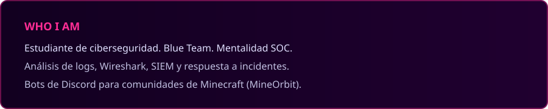
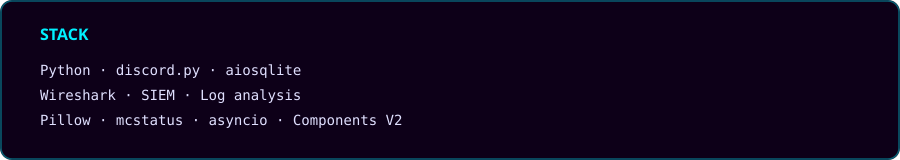

  

 

  
  
  
  
  

 

  

 

  

   
  

 

  

 

## ▸ GitHub Stats

  

  

  <picture>
    <source media="(prefers-color-scheme: dark)" srcset="https://raw.githubusercontent.com/DiomedesMateo/DiomedesMateo/output/github-contribution-grid-snake-dark.svg"/>
    
  </picture>

 

  
  

  

