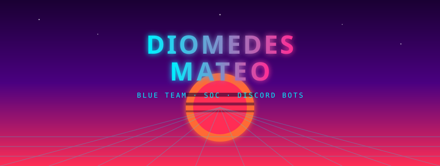
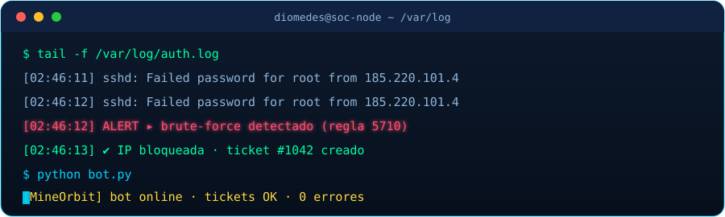

  

  

 

  
  
  
  
  
  

 

## 🛡️ Sobre mí

Estudiante de **ciberseguridad** enfocado en **Blue Team**. Trabajo con mentalidad **SOC**: análisis de logs, Wireshark, SIEM y respuesta a incidentes.

También desarrollo **bots de Discord** para comunidades de Minecraft: tickets, moderación, economía, niveles y herramientas de staff, con Python + `discord.py`.

| | |
|---|---|
| 🔵 **Enfoque** | Defensa y detección |
| 🎮 **Comunidades** | Herramientas para servidores de Minecraft |
| 🛠️ **Me muevo en** | Automatización, bases de datos y lógica compleja |

  

## 🧰 Stack

| Área | Tecnologías |
|---|---|
| **Ciberseguridad** | Blue Team · Análisis de logs · Wireshark · SIEM |
| **Lenguajes** | Python · Java · JavaScript |
| **Discord** | discord.py · Components V2 · Views |
| **Datos** | SQLite · aiosqlite |
| **Otros** | Pillow · mcstatus · asyncio |

## 🎮 Juegos que me gustan

**Favorito** 

**Otros** 

## 📊 Estadísticas

  

  

### 🐍 Contribuciones

  <picture>
    <source media="(prefers-color-scheme: dark)" srcset="https://raw.githubusercontent.com/DiomedesMateo/DiomedesMateo/output/github-contribution-grid-snake-dark.svg"/>
    
  </picture>

## 📬 Contacto

  
  

 

  

